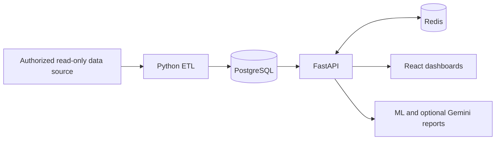

# DigMaco Analytics

Final-year Computer Engineering project (2025–2026): a full-stack platform for
subscription behavior analytics, retention, churn analysis and reporting.

Author: **Yassine Ben Hawala** · [Portfolio and screenshots](https://portfoliohawala.vercel.app/project)

## What this project demonstrates

- Python ETL into a PostgreSQL analytical warehouse.
- FastAPI endpoints, JWT authentication and administrator/analyst permissions.
- React dashboards for usage, retention, campaigns and churn.
- SQL indexing and Redis caching for analytical queries.
- Machine-learning modules and optional Gemini-generated reports.

This repository is the complete DigMaco project; its ETL is a component of the
same PFE, not a separate professional engagement.

## Architecture



| Path | Purpose |
| --- | --- |
| `user-analytics-backend/app/` | API, repositories and business rules |
| `user-analytics-backend/scripts/etl/` | Source-to-warehouse integration |
| `user-analytics-backend/alembic/` | Database migrations |
| `user-analytics-backend/tests/` | Authentication, RBAC and analytics regressions |
| `analytics-platform-front/` | React/Vite interface |
| `docs/architecture.md` | Detailed architecture notes |

## Local Docker setup

Use Docker Compose v2. Copy `.env.example` to `.env`. Generate **separate** random
hex strings for `POSTGRES_PASSWORD` and `SECRET_KEY`, for example with
`python -c "import secrets; print(secrets.token_hex(32))"`. Do not reuse values
from earlier commits. Optional admin bootstrap is disabled unless both
`ADMIN_EMAIL` and a new strong `ADMIN_PASSWORD` are explicitly configured locally.

```sh
docker compose up -d analytics_postgres analytics_redis
docker compose run --rm analytics_backend python scripts/init_demo_database.py --confirm-empty-demo --users 200
docker compose up --build analytics_backend analytics_frontend
```

Interface: http://localhost:5173 · API docs: http://localhost:8000/docs.
This starts an isolated analytical database with 200 explicitly synthetic users.
It does not connect to production or load real customer data. ETL requires a separately
authorized source configured with `PROD_CONN`; never use a write-enabled source
account. The small generator supplies users, subscriptions, one service and activity events;
it does not reproduce all billing/campaign/ML scenarios.

For host-based development, copy `user-analytics-backend/.env.example` to that
directory's `.env`, configure local PostgreSQL/Redis and a fresh `SECRET_KEY`, then
install `requirements-dev.txt`, run `python scripts/init_demo_database.py --confirm-empty-demo --users 200`
against a new `analytics_demo` database, then run `make dev`. The frontend path
is `analytics-platform-front` (copy its `.env.example`, then `npm ci && npm run dev`).

## Tests and verification

```sh
cd user-analytics-backend
python -m pip install -r requirements-dev.txt
python -m pytest -q
```

Some tests need a disposable PostgreSQL schema and Redis. CI provides
these services. Never point tests or seeders at a real production database.
Frontend compilation: `cd analytics-platform-front && npm ci && npm run build`.
The workflow reports the actual outcome; its existence alone does not mean tests pass.

## Performance evidence

The CV reports one endpoint improving from 6.1 s to 1.3 s. Treat this as a specific
historical measurement, not a guarantee for every endpoint or environment.
Use `user-analytics-backend/scripts/benchmark_cache_endpoints.py` to investigate
and record endpoint, dataset size, hardware, repetitions and warm/cold-cache
conditions before publishing a reproducible comparison.

## Data, security and limitations

Demonstrations must use synthetic or explicitly authorized data. Do not publish
customer identifiers, connection strings, keys or private reports. Gemini is
optional; assess data-sharing permissions before enabling it. Local Compose is
not a production deployment: review HTTPS, CORS, backups and monitoring first.
The JWT signing key is required; the old `change-me` fallback is rejected.

Documentation and presentation work do not imply that every analytical or ML
assumption has been independently validated.

## Inherited migration limitation

The original Alembic baseline is empty and later revisions assume pre-existing
tables. Consequently `alembic upgrade head` cannot initialize a brand-new database.
The demo bootstrap creates the current ORM schema only in a completely empty
PostgreSQL database whose name ends in `_demo` or `_test`, after explicit confirmation.
It neither stamps nor rewrites the historical revisions. Do not run those legacy
migrations over the demo schema or use the bootstrap for an existing deployment.
A production migration baseline still requires a separate schema reconciliation.
